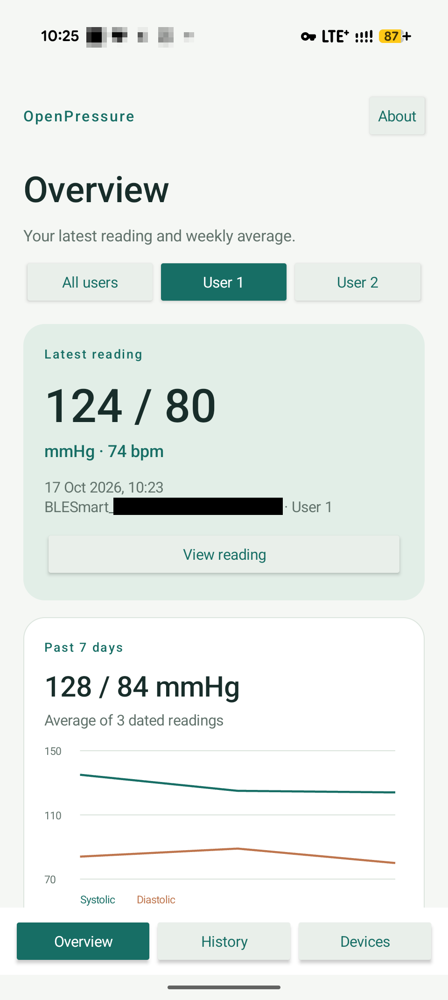
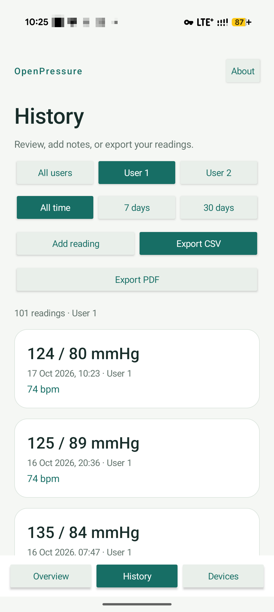
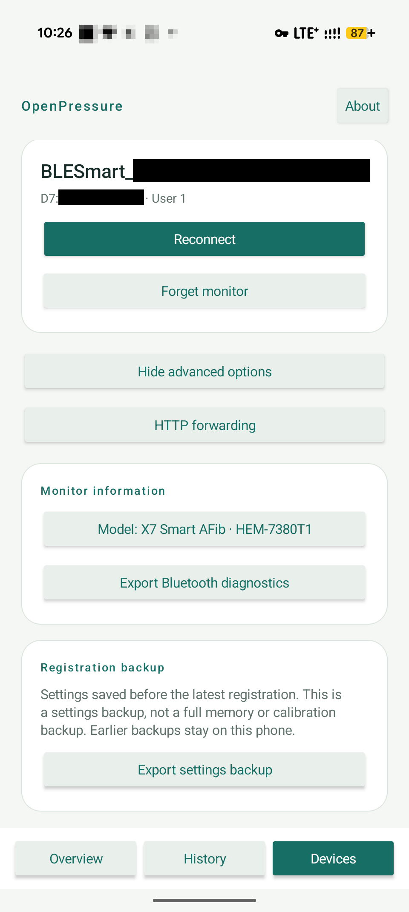
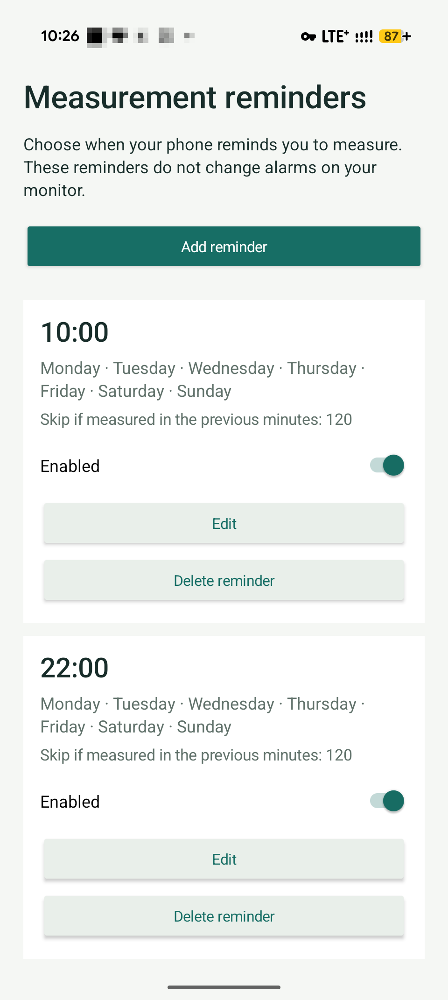

# OpenPressure

**Your blood pressure readings, together on your phone.**

OpenPressure is a free, open-source Android app that helps you keep track of your blood pressure. Bring readings over from a compatible Bluetooth monitor or add them by hand, see how they change over time, and create a report to share at your next appointment.

No account to create, no subscription, and no cloud service required. Your readings stay on your phone by default, and you choose whether to share them.

[Download an APK](https://github.com/scolastico/open-pressure/releases) · [Getting started](#getting-started) · [Supported monitors](#supported-monitors) · [Documentation](docs/README.md)

## Take a look

<table>
  <tr>
    <th>Overview</th>
    <th>History</th>
    <th>Devices</th>
    <th>Reminders</th>
  </tr>
  <tr>
    <td></td>
    <td></td>
    <td></td>
    <td></td>
  </tr>
</table>

## What you can do

| Feature | What it means for you |
| --- | --- |
| **Bring your readings together** | Import stored readings from a compatible Bluetooth monitor, or add a reading by hand. See [monitor compatibility](#supported-monitors) below. |
| **See changes over time** | View your latest reading, weekly averages, and blood pressure and pulse charts. Filter history by person and date. |
| **Add context** | Keep notes alongside readings so you can remember what was happening that day. |
| **Share a report** | Export a PDF with charts, summaries and detailed readings, or a CSV file for a spreadsheet. Choose the person and date range you need. |
| **Keep people separate** | Use the monitor's User 1 / User 2 choices, or create [named profiles](docs/virtual-users.md) and choose who each new reading belongs to. |
| **Set measurement reminders** | Choose times and weekdays for [phone notifications](docs/reminders.md), with an option to skip a reminder if you measured recently. |
| **Import automatically** | The tested X7 has [automatic import options](docs/automatic-import.md), including background modes. Availability and timing depend on Android settings and the monitor. |
| **Connect to other health apps** | Optionally send blood pressure readings for your selected person to [Health Connect](docs/health-connect.md). Off by default; pulse, notes and AFib flags are excluded. |
| **Use your own server** | Advanced users can enable [HTTP forwarding](docs/http-forwarding.md) to a server they choose, with an option to keep new readings out of local history. Off by default. |
| **Choose your language** | The interface includes [52 language and region options](docs/localization.md). Translation improvements are welcome. |

## Supported monitors

**Check the model number printed on your monitor before pairing.** Similar product names can refer to different devices, and a Bluetooth logo alone does not establish compatibility.

| Monitor / model number | Status in OpenPressure |
| --- | --- |
| **Omron X7 Smart AFib — HEM-7380T1-EOSL** | **Tested:** initial pairing, clock setup and manual history import confirmed on this exact model. |
| Omron HEM-7150T, HEM-7155T, HEM-7156T | History import implemented; **not yet tested on physical monitors in OpenPressure**. |
| Omron HEM-7322T, HEM-7342T, HEM-7361T | History import implemented; **not yet tested on physical monitors in OpenPressure**. |
| Omron HEM-7530T, HEM-7600T, HEM-6232T | History import implemented; **not yet tested on physical monitors in OpenPressure**. |
| Omron BP5360 — HEM-7377T1 | History import implemented; **not yet tested on a physical monitor in OpenPressure**. |
| Other monitors using the standard Bluetooth Blood Pressure Service | Support implemented and tested in software; **physical compatibility unconfirmed**. |
| Other models or regional variants | Compatibility is not established. Unknown monitor memory layouts are blocked. |

The additional ten Omron models above support manual history import paths; background automatic imports are not enabled for those paths. Accepted regional model numbers and details about each connection method are in the [full compatibility guide](docs/compatibility.md) and [model reference](docs/omblepy-comparison.md#accepted-identities-and-record-handling).

> **OpenPressure is experimental.** Incorrect operation or device damage is possible; the app asks you to accept this before first use. Confirmed results apply to the exact model and operations listed above. See the [safety guide](docs/safety.md) for details. OpenPressure is independent and is not affiliated with Omron.

## Getting started

You need an **Android phone running Android 8 or newer**. Bluetooth is needed to connect a monitor; you can also enter readings manually.

1. **Install the app.** Download the Android installation file (`.apk`) from [GitHub Releases](https://github.com/scolastico/open-pressure/releases), install it on your phone, and read the first-use notice.
2. **Connect your monitor.** Enable Bluetooth, allow the requested permissions, and open **Devices**. Put the monitor in pairing mode as described in its manual, scan, and choose **Pair** for initial setup. Follow the app's prompts and check the exact model label before confirming registration.
3. **Import your readings.** For routine use, choose **Connect**, then **Import monitor history**. Wake the monitor again if it has powered off. Repeated imports avoid duplicate stored readings, and an interrupted import keeps readings already saved.
4. **Explore your history.** Open **Overview** or **History**, select a person, review charts, add notes, or export a report. **Add reading** lets you enter a measurement by hand.

Android 8–11 also require location permission and Location Services to scan for monitors. Pairing steps vary by model: the [usage guide](docs/usage.md) covers setup, permissions and troubleshooting. Follow your monitor's own instructions when taking a measurement.

## Your data stays in your hands

- **Private by default.** Readings stay in private app storage. There is no account, analytics or OpenPressure-hosted backend. Network access is used only for optional forwarding to the server you configure.
- **Sharing is your choice.** PDF and CSV exports are created on your phone. Health Connect and HTTP forwarding are optional and off by default. Forwarding without local history still uses a temporary queue until your server accepts the readings.
- **Local deletion stays local.** Deleting readings in OpenPressure leaves the monitor's memory and copies already shared with Health Connect or a server intact.
- **Export before uninstalling.** Android app backup and device transfer are disabled. Save any readings you want to keep before removing the app. Exports can contain health data and device identifiers; review them before sharing.

## Help and contributions

The [documentation index](docs/README.md) is the starting point for detailed guides. For everyday use, start with [using a monitor](docs/usage.md), [automatic imports](docs/automatic-import.md), [reminders](docs/reminders.md) or [named profiles](docs/virtual-users.md).

Bug reports, translation fixes and contributions are welcome. Read [CONTRIBUTING.md](CONTRIBUTING.md) for what to include and how to keep health data, device identifiers and pairing details private when reporting an issue.

**For developers:** [Development](docs/development.md) covers build requirements, source layout and validation commands. The [protocol reference](docs/protocol.md), [safety boundaries](docs/safety.md) and [hardware validation guide](docs/hardware-validation.md) explain device integration. Maintainers can find signing and publishing instructions in [GitHub releases](docs/releasing.md).

## License

[MIT](LICENSE) · Copyright (c) 2026 Joschua Becker EDV.
